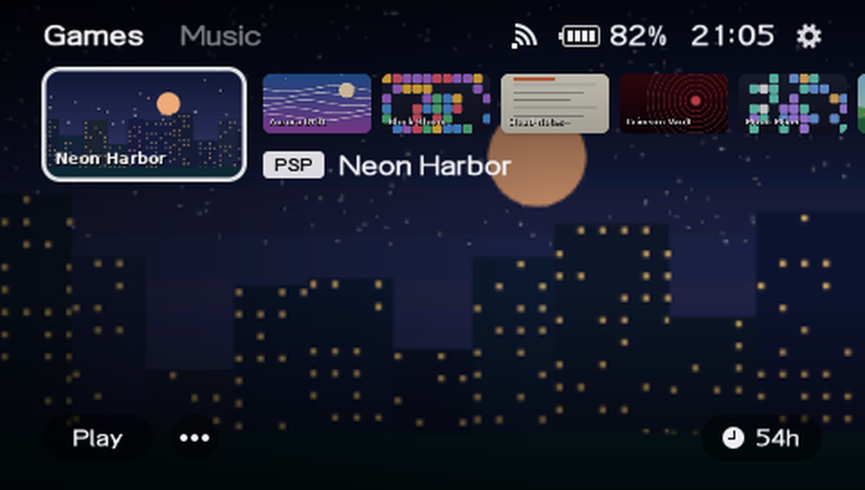
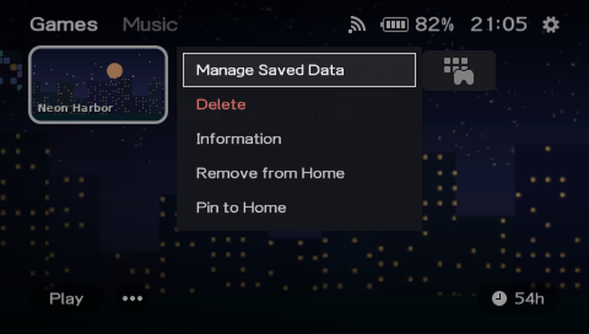
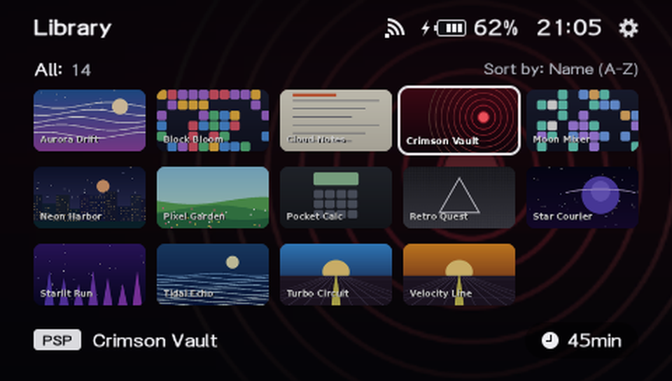
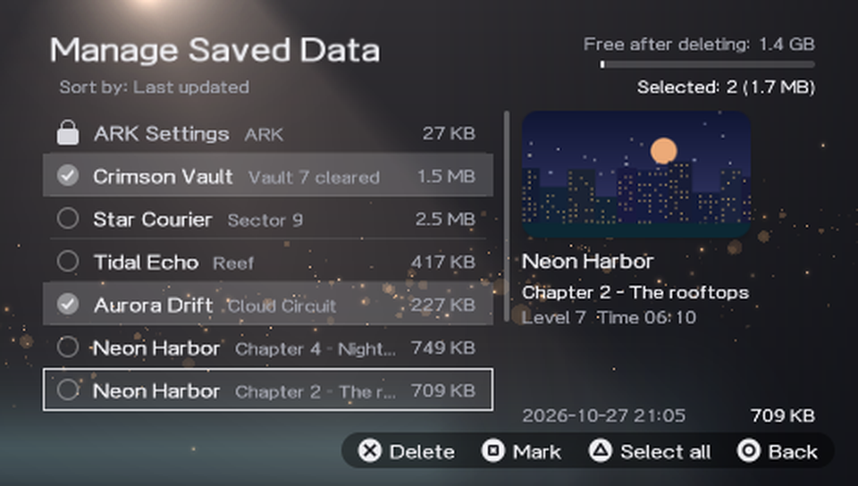
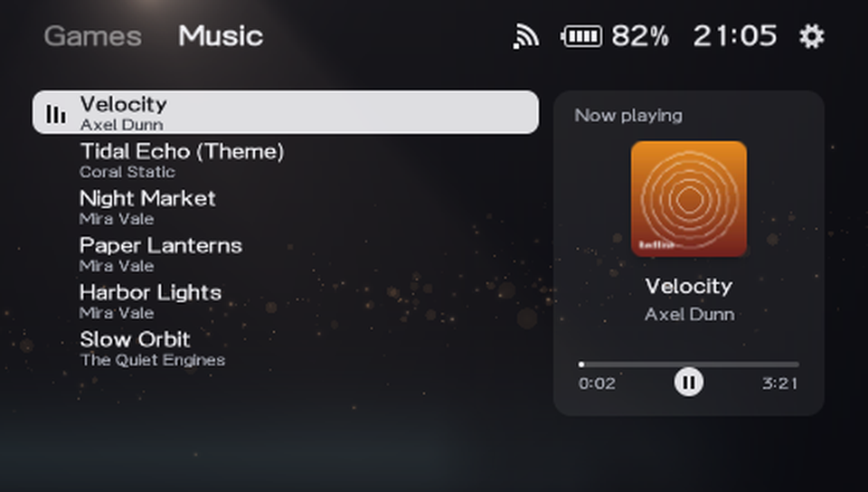
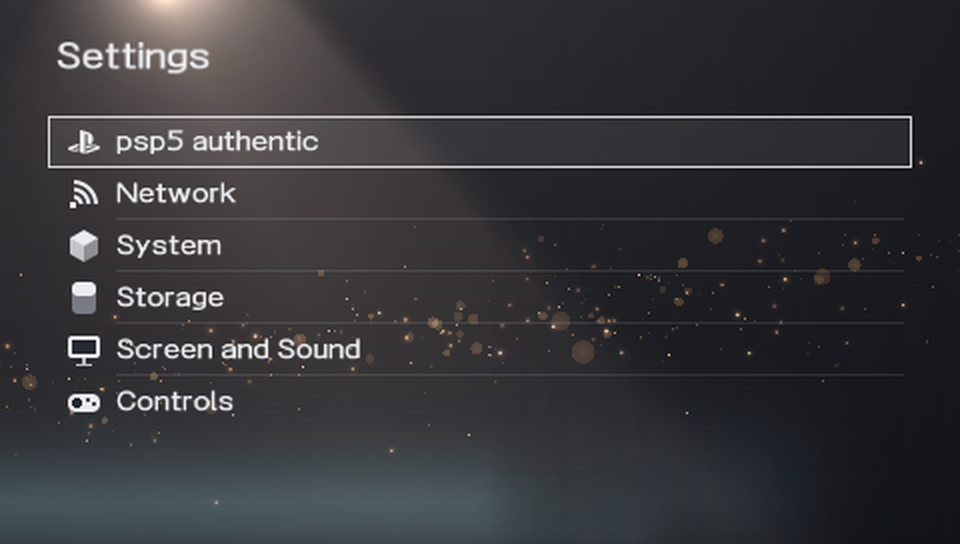
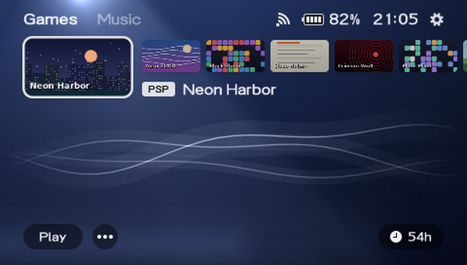
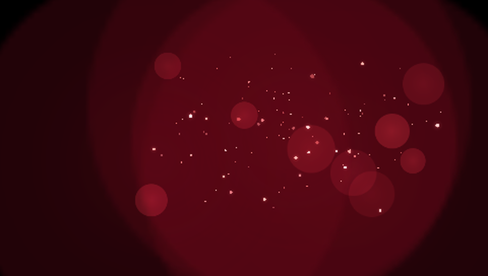

# psp5-authentic

A launcher for PSPs with **ARK-4 or ARK-5** that looks and feels like the user interface of a modern **home console** –
on the PSP's 480×272 screen. You move through it with the D-pad alone.

psp5-authentic is a fork of [psp5](https://github.com/08Weber/psp5) by Mille Weber (08Weber), based on psp5 v1.5.3. It has
one goal of its own: to be **as authentic as possible to its home console counterpart**. Where the console does something,
this fork does it the same way. This is version 1.1.0 (1.0.0 was the first release); everything that changed compared with psp5 is in the
[release notes](CHANGELOG.md). Many thanks to Mille Weber – all of this stands on that work.

<table>
  <tr>
    <td width="50%"><br><sub><b>Games</b> – the games you played last and the ones you pinned, with the Library as the last card</sub></td>
    <td width="50%"><br><sub><b>Options</b> (START) – saved data, information, pin to or remove from Home, delete</sub></td>
  </tr>
  <tr>
    <td width="50%"><br><sub><b>Library</b> – everything on the card in one grid, sorted by name or by what you added last</sub></td>
    <td width="50%"><br><sub><b>Manage Saved Data</b> – look through saves, mark several and delete them, with the space you get back</sub></td>
  </tr>
  <tr>
    <td width="50%"><br><sub><b>Music</b> – your MP3s with album art; the music keeps playing while you browse your games</sub></td>
    <td width="50%"><br><sub><b>Settings</b> – psp5, themes, ARK options, plugins, power and USB</sub></td>
  </tr>
  <tr>
    <td width="50%"><br><sub><b>Themes</b> – console colours and the classic looks of older consoles (here the XMB wave)</sub></td>
    <td width="50%"><br><sub><b>Startup</b> – the circles and the golden dust take the colours of your theme (here Cosmic Red)</sub></td>
  </tr>
</table>

*The screenshots were taken in an emulator with invented demo games, music and saves.*

## What you get

- **Games (Home).** Your last played games and apps plus the ones you pinned, in one row. The selected card is big, with its
  artwork behind it. ↓ selects the **Play** and **⋯** (options) buttons. A UMD in the drive shows up first.
- **Time played.** A small clock with the time (*54h*, *45min* or *<1min*) on the right of the bottom row, in Games and in the Library. It
  counts only when psp5 is ARK's launcher (see *Optional: replace ARK's Custom Launcher with psp5* in `INSTALL.md`, with *Boot into psp5* turned on; *Settings → psp5* says
  *psp5 is ARK's launcher: Yes*): ARK then starts psp5 again when a game ends. That is the case when psp5 was opened with the Custom Launcher entry in the XMB or by ARK itself; started from Game → Memory Stick as a normal app, psp5 does not note the game and nothing is counted. Time the PSP spends asleep or switched off during a game is counted too (up to a day).
- **Options** (START, or ✕ on ⋯). Manage Saved Data, Information, Delete, Remove from / Add to Home, Pin to / Unpin from Home.
- **Library.** The last card of Games. It opens a grid with everything you have, games and apps together, a **Sort** button (by
  name or by what you added last) and a **view** button (*All*, *In folders*, *Outside of folders* or *Both in and out of
  folders*; the folders are cards, ✕ opens one, ○ goes back). Folders are the ones the Categories Lite plugin makes. The Library
  remembers your sorting and view. You can pin the Library card like any other card.
- **Manage Saved Data.** Lists the saves of all your games. Mark some, delete them and see how much room you get back.
  ARK's own save folder is locked and can't be deleted.
- **Music.** Plays the MP3 files in `MUSIC` with title, artist and album art (from the file, or a `cover.jpg` / `folder.jpg`
  in the folder). It keeps playing while you browse your games.
- **Settings** (the cog wheel). *psp5* (boot into psp5, sounds, startup animation, battery percentage, language), *Theme*,
  *Performance* (CPU speed, extra memory, caches), *System*, *Plugins* and *Power and USB* (USB mode, file manager, XMB,
  sleep, shut down, restart, recovery menu).
- **Themes.** The colours of the console covers, each with the console's scene behind your games (a beam of light, golden
  dust, haze), plus the classic looks of PS1 to PS4. Highlight a theme to preview it, ✕ to use it. You can turn the game art
  in the background off, so the theme is always visible.
- **Startup.** A short intro like a console's, with a health notice, soft circles and golden dust in your theme's colours.
  It plays when the PSP starts and wakes up, not when you come back from a game. Any button skips it, and you can turn it off.
- **Power popup** (SELECT, on every tab). Sleep, Shut down, Restart, Recovery menu – ✕ does it at once.
- **Volume and battery.** Pressing the volume buttons slides a volume bar in at the top. The battery icon fills up in a loop
  while the PSP charges. You can also show the battery percentage (*Settings → psp5*).
- **File manager** (*Settings → Power and USB*). Browse the Memory Stick (and the internal storage on a PSP Go) and copy,
  move, rename, delete or make folders.
- **Sounds and languages.** Menu sounds (you can turn them off). 11 languages: psp5 follows the PSP's language; Swedish and
  Czech are picked under *Settings → psp5 → Language*.
- **Quick and careful.** Only the cards near your selection are loaded, and artwork is cached, so it opens fast after the
  first start. psp5 never touches flash0 and you can always get back to the XMB.

Games and apps use their own icon and background automatically. If you want your own covers, see *Covers* in
[INSTALL.md](INSTALL.md).

## Buttons

| Button | What it does |
|---|---|
| ← → or the analog stick | Move between cards (hold to go faster) |
| ↑ ↓ | Move between rows in the Library · in Games, ↓ selects Play / ⋯ and ↑ goes back |
| ↑ from the first thing on a tab | Select the top bar (tabs, cog wheel): ← → move, ✕ opens, ↓ goes back down |
| ✕ | Start a game · open the Library from its card · open a tab or Settings from the top bar |
| ○ | Back · closes the Library |
| START | Options of the selected card |
| SELECT | Power popup |
| L / R | Switch between Games and Music |
| Music: ✕ or □ · ← → | Play / pause · previous / next track (hold to seek) |
| HOME | Quit to the XMB |

More details and a few other buttons are in [INSTALL.md](INSTALL.md).

## Install

Download the zip for your PSP from the [Releases](../../releases) page and follow **[INSTALL.md](INSTALL.md)**. It works as a
normal app, or as ARK's own launcher so your PSP boots straight into it. There is a download for each ARK version (4 or 5),
also for the PSP Go.

If something goes wrong, hold **SELECT** while the PSP starts: ARK skips its settings and you land in the normal XMB. If a
start doesn't finish (the PSP froze, for example), the next one is a *safe start* without the startup screen, music and UMD.
If that fails too, psp5 sends the PSP to the XMB. More help is in [INSTALL.md](INSTALL.md).

## What has been tested

Works on the **PSP-1000, 2000, 3000 and PSP Go** with **ARK-4 or ARK-5**; it adapts its settings to your model and ARK
version (the PSP-1000 has no extra memory or USB charging, ARK-4 has fewer CPU speeds). The PS Vita isn't supported.

Every update is tested on a **PSP-1000**, the only device used for testing. The other models and the two ARK versions are
expected to work but aren't tested separately. Claude also runs automated checks on a PC; they are not part of this
repository. If something behaves oddly on your PSP, please open an issue and tell us what you saw and which PSP and ARK you
have.

## About this fork

psp5-authentic is **Claude's work**: the code and the documentation are written by Claude, an AI assistant made by Anthropic.
The person who runs the fork has almost no coding experience. They test every update on their own PSP and report back what
they see, and the two of them work out the solutions together. So there will be bugs, and reports are what makes the project
better.

Everything you see is drawn by psp5 itself. No logos, icons, sounds or other assets from Sony are used – it's an own take on
that style.

## Building it yourself

psp5 is written in C and built with the [pspdev](https://github.com/pspdev/pspdev) toolchain plus
[psp-cfw-sdk](https://github.com/pspdev/psp-cfw-sdk), which provides ARK's headers and libraries. With pspdev installed:

```sh
make            # ARK-5 version
make ARK=4      # ARK-4 version
```

On Windows it is built inside WSL: `tools/setup-wsl.sh` installs the toolchain and `tools/build.sh` builds
`dist/PSP/GAME/PSP5/EBOOT.PBP` (`tools/build.sh ark4` for ARK-4). Both versions also run on the PSP Go. What each change
touches in the code is written down in [docs/DEVELOPER-NOTES.md](docs/DEVELOPER-NOTES.md).

## Thanks

- **Mille Weber (08Weber)**, who made [psp5](https://github.com/08Weber/psp5), the project this fork is based on (v1.5.3).
- The [ARK-5](https://github.com/PSP-Arkfive) and [ARK-4](https://github.com/PSP-Archive/ARK-4) teams – psp5 starts games and
  stores settings the same way their arkMenu does, and uses ARK's libraries through psp-cfw-sdk.
- [pspdev](https://github.com/pspdev) for the toolchain, PSPSDK and packages.
- intraFont, libpng, zlib, LZ4 and libcisoread.

## License

GPL-3.0 – see [LICENSE](LICENSE).

psp5-authentic is a modified version of psp5 v1.5.3 by Mille Weber, changed in 2026. The copyright notices of the original
are kept in the source files; what was changed is listed in the [release notes](CHANGELOG.md).

psp5 and psp5-authentic are unofficial fan projects (by Mille Weber, and a fork of it). They are not affiliated with or
endorsed by Sony Interactive Entertainment. "PSP" and "PlayStation" are trademarks of Sony Interactive Entertainment Inc.
